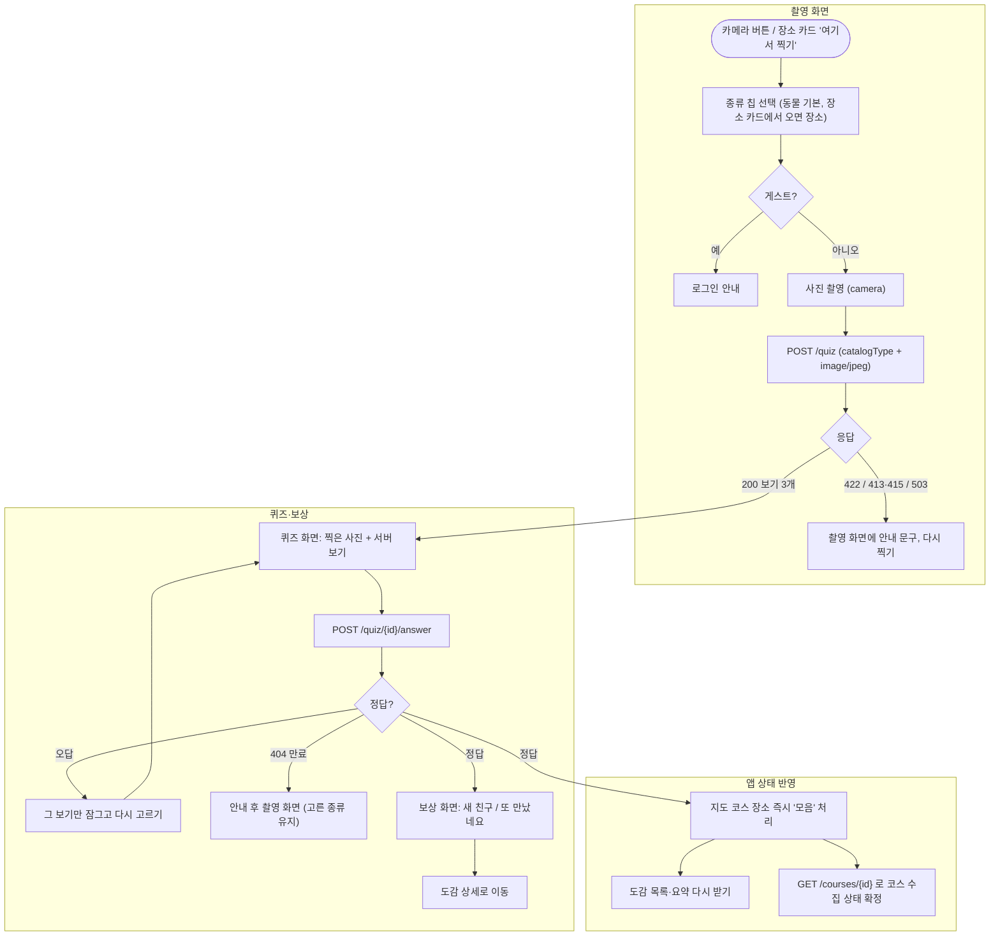
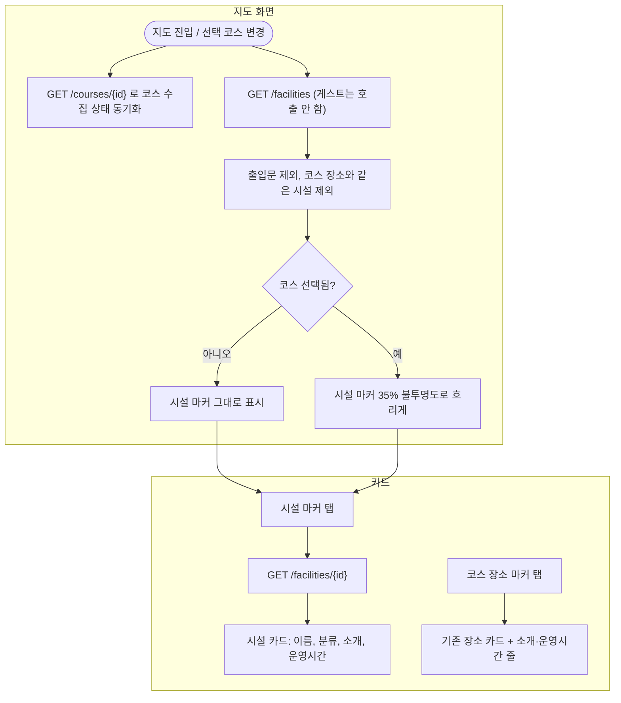

<!-- projectops:report -->
# 사진 촬영 퀴즈와 시설, 코스 상세 API 연동

## 개요

이전까지 촬영과 퀴즈는 진짜로 동작하지 않았다. 촬영 화면에는 카메라가 없었고, 셔터를 누르면 앱에 들어 있던 예시 문항(`quiz.json`)이 순서대로 나왔다. 보상 화면은 찍은 것과 상관없는 도감 코드로 수집 API를 불렀다.
BE에 사진 인식 퀴즈 API가 머지되면서(BE #39) 이번에 실제 루프를 완성했다. 흐름은 `촬영 → 서버 인식 → 3지선다 → 정답이면 서버가 도감 수집`이다.

같은 이슈에서 앱이 아직 부르지 않던 회원용 API 두 묶음도 연결했다.
- 시설 목록·상세 API로 지도에 공원 시설 전체를 보여주고, 카드에 소개와 운영시간을 보여준다.
- 코스 상세 API로 지도의 '모음/아직' 표시를 서버 값으로 맞춘다.

## 기능 흐름

## 변경 사항

### 시설 (지도)
- `lib/features/map/data/`, `domain/`, `presentation/providers/facility_provider.dart`: 시설 목록·상세 API 데이터 계층과 목 데이터(`assets/mock/facilities.json`). 게스트는 호출하지 않고, 출입문(`category == '출입문'`)은 제외하며, 실패하면 빈 목록이나 null로 처리한다.
- `lib/features/map/presentation/map_facility_layer.dart`: 코스 장소와 겹치는 시설을 거르는 순수 함수, 흐림 불투명도 0.35.
- `widgets/facility_marker.dart`, `facility_marker_icon.dart`, `park_google_map.dart`, `park_schematic_map.dart`: 실제 지도와 공원 약도 양쪽에 시설 마커를 그린다. 코스 숫자 마커는 시설 마커보다 위에 그린다.
- `widgets/facility_info_card.dart`, `facility_intro_section.dart`, `place_info_card.dart`, `pages/map_page.dart`: 시설 카드를 추가하고, 코스 장소 카드에는 소개와 운영시간 줄을 더했다. 두 카드는 동시에 열리지 않는다.

### 코스 상세
- `lib/features/course/...`: `GET /courses/{courseId}`, 장소의 `facilityId`, `SelectedCourseSync`(응답이 늦게 와도 다른 코스로 바뀌었으면 덮어쓰지 않음).

### 퀴즈와 촬영
- `lib/features/quiz/data/`, `domain/`: 퀴즈 생성(multipart)과 정답 제출 API, 목 데이터소스(`catalog.json` 기반).
- `presentation/providers/quiz_session_provider.dart`: 화면 사이에서 퀴즈 상태를 들고 다닌다. 정답 제출을 중복 방지하고, 늦게 온 응답은 무시한다. 정답이면 코스·도감 상태를 반영한다.
- `presentation/quiz_messages.dart`: 서버 오류 코드별 안내 문구.
- `lib/features/scan/`: 카메라 프리뷰와 촬영, 종류 칩, 권한 거절과 카메라 없음 안내, 앱 전환 시 카메라 해제와 재개.
- `pages/quiz_page.dart`, `quiz_reward_page.dart`: 서버 퀴즈로 전환했다. 보상 화면의 수집 API 호출은 제거했다.
- 삭제: `quiz.json`, `quiz_question_source.dart`, `QuizQuestionEntity`, `collectCatalogItemByCode`와 관련 테스트.

### 설정·문서
- `pubspec.yaml`/`pubspec.lock`: `camera ^0.12.0+1`을 추가했다(CI Flutter 3.35.5와 호환되는 버전).
- `ios/Runner/Info.plist`: 카메라 권한 문구를 촬영 목적에 맞게 바꿨다. 예전 문구는 QR 스캔 기준이었다.
- `docs/api-docs.json`: BE 최신 명세로 갱신했다(퀴즈 경로 포함).

## 수정 전후 화면

| 화면 | 수정 전 | 수정 후 |
|---|---|---|
| 촬영 | 카메라 없이 어두운 화면에 셔터만 있음. 누르면 예시 문항으로 이동 | 실제 카메라 프리뷰. 셔터 위에 동물·식물·장소 칩이 있고, 고른 종류 색으로 프레임과 셔터가 바뀜 (시안 A안) |
| 지도 | 고른 코스 장소만 표시 | 공원 시설 전체 표시. 코스를 고르면 나머지 시설은 흐리게 표시 (시안 A안) |

시안(HTML 재현, 결정안):

> 실기기 화면 녹화(GIF)는 아래 '실기기 확인' 항목을 마친 뒤 추가한다.

## 주요 구현 내용

- **사진은 항상 `image/jpeg`로 보낸다.** 서버는 파트 Content-Type이 허용 형식이 아니면 415를 준다. 그래서 파일 확장자에 기대지 않고 `quiz.jpg` + `image/jpeg`로 명시한다. 고정한 retrofit 4.7.3의 생성기는 단일 `MultipartFile` 파트를 만들지 못해 원소 1개짜리 리스트로 넘기지만, 실제 전송 형식은 같다(필드 `image`, 쿼리 `catalogType`).
- **늦게 온 응답은 버린다.**
  - 정답 제출: 퀴즈 세션이 그사이 지워지거나 새로 시작됐으면 결과를 반영하지 않는다.
  - 코스 상세: 응답이 오기 전에 선택 코스가 바뀌었으면 결과를 반영하지 않는다.
  - 셔터와 보기: 연타해도 요청은 한 번만 나간다.
- **업로드 중 촬영 화면을 닫으면 퀴즈로 넘어가지 않는다.** pop 전환 중에는 위젯이 아직 mounted이므로 `ModalRoute.isCurrent`까지 확인한다.
- **카메라 권한:** Android 권한 다이얼로그는 inactive→resumed만 남긴다. 거절 직후 resumed에서 카메라를 다시 열면 권한을 또 물어서, 두 번 거절하면 영구 거절이 된다. 그래서 '앱이 실제로 백그라운드에 갔다 왔거나, 우리가 카메라를 해제한 경우'에만 다시 연다(`shouldReopenCameraOnResume`, 단위 테스트 있음). '설정 열기'로 다녀오면 다시 열린다.
- **이미 모은 항목을 다시 맞힌 경우:** 서버 응답에는 구분값이 없다. 그래서 퀴즈 시작 때 도감 목록을 함께 받아 두고 판단한다. 실패하면 새로 모은 것으로 처리한다.
- **장소 카드에서 '여기서 찍기'를 누르면 칩이 '장소'로 시작한다.** 코스 장소의 도감 항목은 항상 PLACE이기 때문이다. 카드에 보이는 카테고리는 표시용이라, 예를 들어 맹수마을은 동물로 보인다.
- **게스트 모드(디버그 빌드 전용)에서는 시설, 코스 상세, 퀴즈 API를 부르지 않는다.** 토큰 없이 401을 받으면 강제 로그아웃이 되는 기존 문제를 피하기 위해서다.
- 검증: `flutter test` 419개 통과. `flutter analyze`는 기존 info 5건만 남아 있다(`use_null_aware_elements`). 9개 작업을 작업별로 리뷰한 뒤 브랜치 전체를 최종 리뷰했고, 지적된 결함은 모두 고쳤다.

## 주의사항

- **실기기 확인이 아직 남아 있다.** iOS와 Android 실기기, 실서버로 아래를 확인해야 한다.
  - 동물·식물·장소 촬영 → 오답 → 정답 → 보상(새로 / 다시) → 도감 상세
  - 422 안내, 권한 거절 → 설정 열기 → 복귀 후 프리뷰
  - 백그라운드 복귀 후 프리뷰 재개
  - 시설 마커(코스 없음 / 있음), 카드의 소개와 운영시간, 퀴즈 후 지도 마커 '모음'
  - `ResolutionPreset.high` 사진이 10MB 이하인지
- 구글 지도 시설 마커는 코스 화면이 다시 그려질 때마다 아이콘 비트맵을 다시 굽는다. 기기에서 버벅이면 리스트 비교로 줄인다.
- 로컬 Flutter(3.38)로 `pub get`을 돌리면 `pubspec.lock`의 meta와 test_api가 올라간다. CI(3.35.5)와 맞추려면 커밋하지 않는다. `camera`도 최신판은 Dart 3.10이 필요해서 0.12.0+1로 묶었다.
- 촬영한 JPEG 임시 파일은 정리하지 않는다(캐시에 남는다). 퀴즈 세션은 보상 화면을 나간 뒤에도 남지만, 다음 촬영 때 덮어쓴다.
- 새 주석 일부가 한글만 있다(규칙은 영문 다음 한글). 기존 파일의 관행을 따른 것이라, 일괄 정리할 때 같이 고친다.
